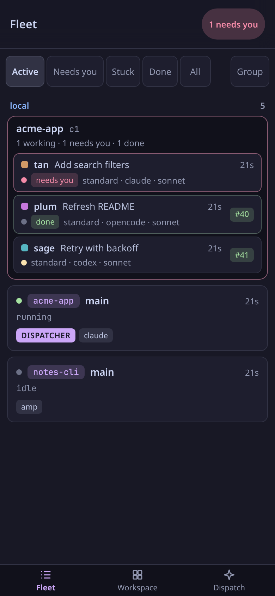
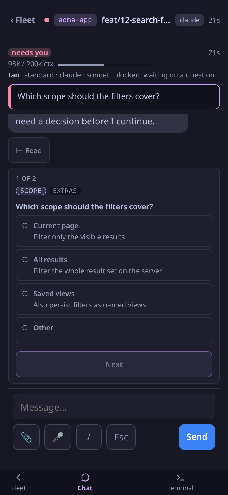
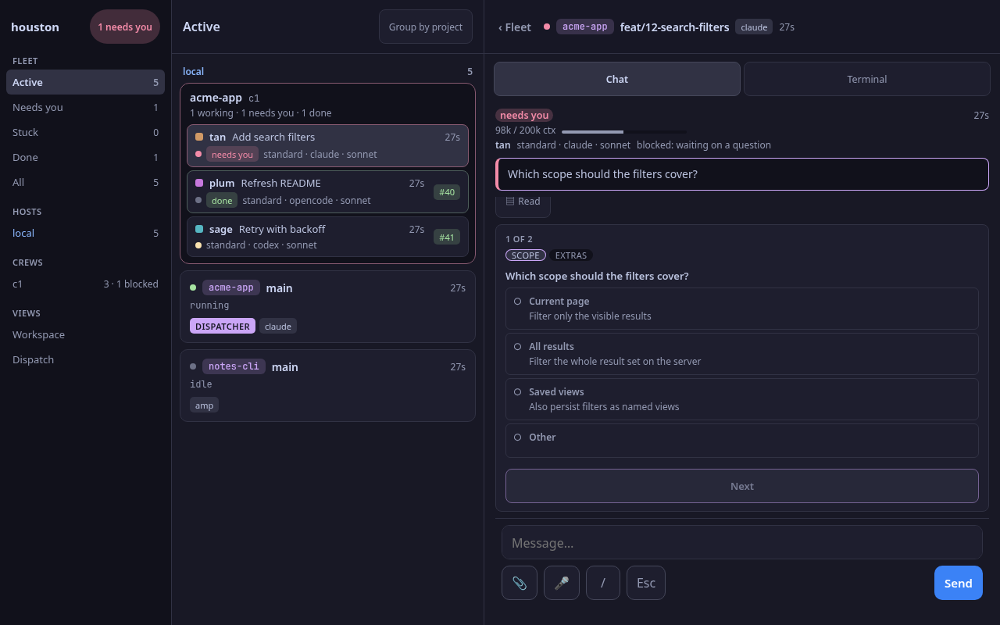

# houston

Mission control for AI coding agents: a mobile-friendly web dashboard for watching your agents, answering their questions and sending them instructions from your phone.

<p>
  
  
</p>

The screenshots use invented data.

## What it does

- **Fleet**: every agent run in one list, with state (thinking, running, blocked, done, ...), the current tool, context usage and PR status. A run that needs a human is marked *needs you*; filters narrow the list to Active, Needs you, Stuck, Done or All.
- **Chat**: the run's transcript as a conversation, live. Permission dialogs and Claude's multi-question prompts (`AskUserQuestion`) can be answered from here, step by step, with Back and a review screen.
- **Terminal**: the run's tmux pane in the browser (xterm.js), with a composer, quick keys, image attach and voice input for the phone.
- **Dispatcher and crew mode**: with the `dispatch` and `crew` CLIs installed, houston can start workers, group a crew under its dispatcher, show the crew bus feed, reply to a worker's question and restart a dispatcher.
- **Federation**: mirror other houston instances (`-peer`) so one Fleet list covers several machines, and dispatch onto a peer.

On a wide screen the same views appear as a three-column console.



## Quick start

Build and run (needs Go, Node and tmux; `nix develop` provides them):

```fish
nix develop
just build
./houston
```

Or build the Nix package: `nix build .#default` puts the binary at `result/bin/houston`.

houston listens on `127.0.0.1:9090` by default. On first run it writes a random access token to `<status-dir>/token`; opening the page issues it to your browser as a cookie. Run `houston doctor` to check the environment.

### Common flags

| Flag | Default | Purpose |
|---|---|---|
| `-addr` | `127.0.0.1:9090` | HTTP listen address |
| `-mode` | `auto` | `auto`, `dispatcher` or `tmux` (see [Modes](#modes)) |
| `-status-dir` | `$HOUSTON_STATE_DIR`, else `~/.local/state/houston` | Hook status files, token, peer tokens |
| `-hostname` | none | Extra `Host` value to accept (repeatable) |
| `-peer` | none | Peer houston to mirror, `NAME=URL` (repeatable) |
| `-peer-token-file` | `<status-dir>/peers/NAME.token` | Token file for a peer, `NAME=PATH` (repeatable) |
| `-repo-root` | `$HOME/git` | Directory the repo registry and picker are confined to (repeatable) |
| `-opencode-url` | none | OpenCode server URL (skips discovery) |
| `-no-opencode` | off | Disable the OpenCode integration |
| `-claude-mod` | on | Listen for the read-only Claude Code mod's records |
| `-debug` | off | Debug logging |
| `-no-auth` | off | Disable the token check (not recommended) |

`houston -h` lists them all; [docs/reference/dev-and-qa.md](docs/reference/dev-and-qa.md) covers the rest.

## Reaching it safely

houston can type into your agents' terminals, so treat access to it like shell access.

- Every `/api/` request needs the token, as the `houston_token` cookie or an `Authorization: Bearer` header.
- Origin and `Host` headers are checked. `Host` is pinned to names derived from the machine itself (hostname, Tailscale address, loopback); anything else gets a 421. Behind a reverse proxy or custom DNS name, add it with `-hostname`.
- The default bind is loopback. To use it from a phone, put a tunnel in front: Tailscale (for example `tailscale serve --bg 9090`) or `ssh -L 9090:localhost:9090 host`.
- `-no-auth` turns off the token only; the Origin and Host checks stay, and forwarding to peers is disabled.

Details, including how peer tokens are handled: [docs/reference/security.md](docs/reference/security.md).

## Modes

`-mode` is resolved once at startup.

**Dispatcher mode** is the full feature set: Dispatch form, reply to a worker, crew feed, restart, repo registry and the crew bus. `auto` picks it when both `dispatch` and `crew` are on the tmux server's `PATH`.

**Tmux mode** is plain tmux plus agent hooks monitoring. The command-running routes are not registered (they return 404), and there is no crew bus. `auto` falls back to it when `dispatch` or `crew` is missing.

Peers and the host list work in both modes. More: [docs/reference/modes-and-architecture.md](docs/reference/modes-and-architecture.md).

## Supported agents

| Agent | How houston sees it |
|---|---|
| Claude Code, Amp | tmux session monitoring, plus hooks and transcripts for Claude Code |
| OpenCode | its HTTP/WebSocket API |
| pi, Codex, Cursor | hookyard's normalized hook envelope; Fleet shows the engine as the run's agent |

### Hooks

Hook events give houston the state a pane alone cannot (a permission dialog waiting, a turn ending). Register them for Claude Code with:

```fish
houston hooks install     # add --dry-run to print the result without writing
houston hooks check       # report which hooks are missing
```

`contrib/claude-mod/` is an optional read-only Claude Code hooks module that feeds houston richer session records over a Unix socket (`claude --plugin-dir contrib/claude-mod`). Details: [docs/reference/hooks-and-state.md](docs/reference/hooks-and-state.md).

### OpenCode

OpenCode's TUI picks a random port that houston cannot discover. Either start it on a fixed port (`opencode --port 4096`; houston scans 4096-4100), pass `-opencode-url http://localhost:PORT`, or install the plugin so houston finds it on its own:

```fish
cp contrib/opencode-plugin/houston.ts ~/.config/opencode/plugins/
```

Restart OpenCode after installing the plugin. All options: [docs/reference/dev-and-qa.md](docs/reference/dev-and-qa.md).

## Development

Backend in Go (single binary; `gorilla/websocket` and `fsnotify` are the only dependencies), frontend in React + TypeScript + Vite with xterm.js, embedded into the binary with `go:embed`. The run list streams over SSE; pane I/O uses WebSocket.

| Command | What it does |
|---|---|
| `just dev` | Go backend with hot reload on the first free port in 7474-7479 |
| `just ui-dev` | Vite dev server with HMR on 5173, proxying `/api` to the backend |
| `just ui-build` | Production frontend build into `ui/dist` |
| `just build` | Build the `houston` binary (embeds `ui/dist`) |
| `just test`, `just lint`, `just race` | Go tests, linters, race detector |

Setup, the git hooks and the CI commands are in [CLAUDE.md](CLAUDE.md) under "Development Setup".

```
main.go, embed.go   entry point, flags, go:embed of ui/dist
server/             HTTP server, routes, WebSocket pane I/O, dispatch, peer forwarding
runs/               run registry: tmux, hook, crew and peer sources
hub/ hook/          session discovery and transcripts; `houston hook` ingest
chat/ crewfeed/     transcript readers and crew feed (standard library only)
tmux/ opencode/     tmux CLI wrapper; OpenCode client
peer/ mode/         federation; dispatcher vs tmux mode
ui/                 React frontend
docs/               reference docs, specs and plans
```

## Docs

Reference docs in [docs/reference/](docs/reference/):

- [modes-and-architecture.md](docs/reference/modes-and-architecture.md): modes and the architecture diagram
- [fleet-runs.md](docs/reference/fleet-runs.md): run composition, needs-you, attention, Fleet grouping
- [chat.md](docs/reference/chat.md): the Chat tab and answering prompts from it
- [terminal-and-mobile.md](docs/reference/terminal-and-mobile.md): the terminal WebSocket protocol and mobile features
- [navigation.md](docs/reference/navigation.md): hash routes and history
- [hooks-and-state.md](docs/reference/hooks-and-state.md): hooks, the Claude mod, background tasks, context meter
- [crew-feed.md](docs/reference/crew-feed.md): the crew activity feed
- [dispatch.md](docs/reference/dispatch.md): dispatching workers and dispatchers, the repo registry
- [federation.md](docs/reference/federation.md): peers and forwarding
- [security.md](docs/reference/security.md): token, Origin and Host checks
- [dev-and-qa.md](docs/reference/dev-and-qa.md): OpenCode setup, load measurement, QA harness

Design notes and plans live in `docs/superpowers/` and `docs/design/`.

## Credits

Built on [xterm.js](https://xtermjs.org/), [React](https://react.dev/), [Vite](https://vite.dev/) and [gorilla/websocket](https://github.com/gorilla/websocket).
